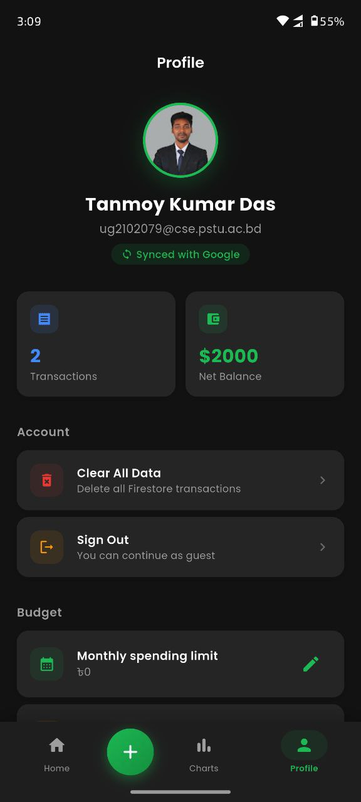
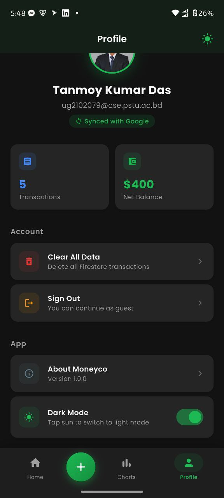
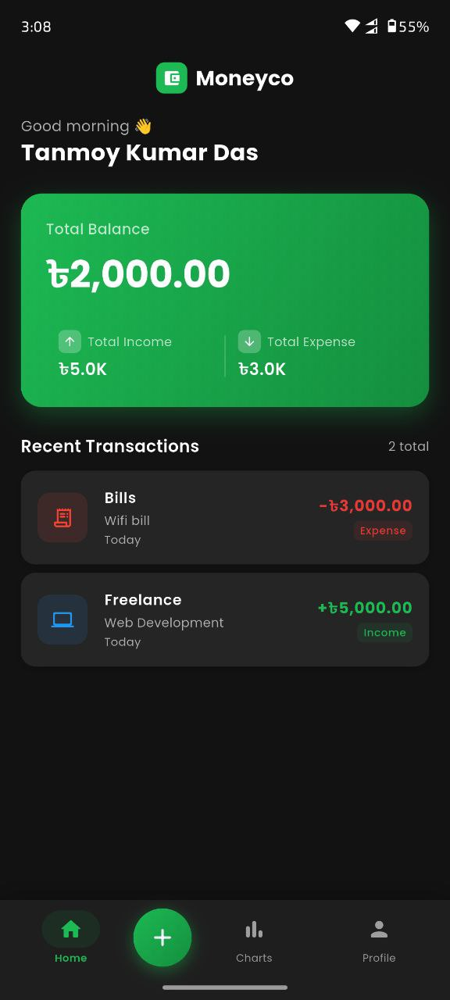
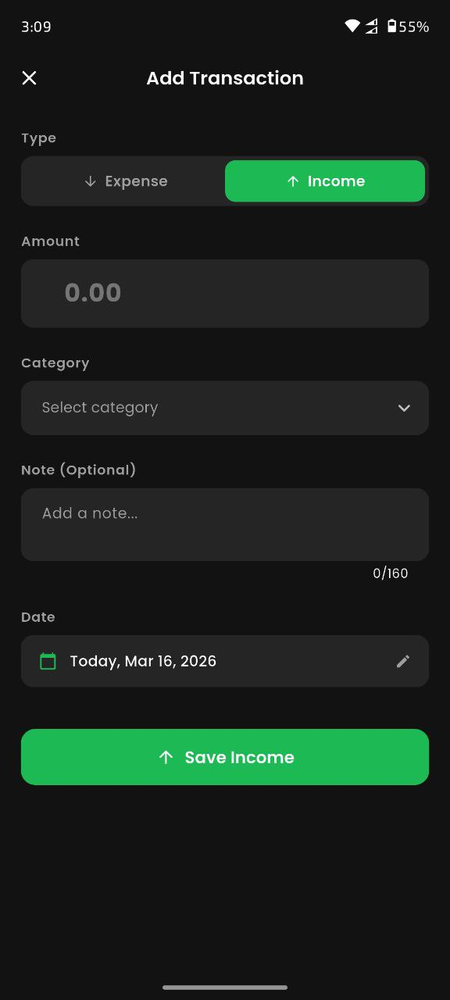
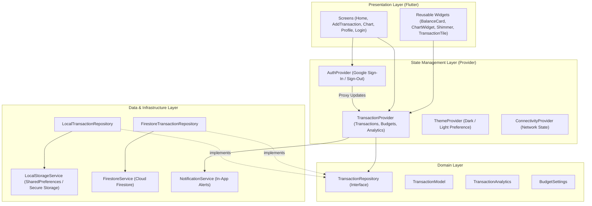

# Moneyco – Personal Finance & Budget Management Platform

<p align="center">
  
</p>

<p align="center">
  <strong>An offline-first, cloud-synchronized personal finance tracking application built with Flutter, Provider, and Firebase.</strong>
</p>

<p align="center">
  
  
  
  
  
  
  
</p>

---

### Project Attribution & Context
* **Platform Target:** Developed for the **bdapps** developer ecosystem.
* **Development Methodology:** Designed and engineered following modern Clean Architecture principles, with assistance from AI-augmented engineering tools.
* **Author & Maintainer:** Tanmoy Kumar Das ([@tanmoykdas](https://github.com/tanmoykdas))

---

## 1. Executive Summary

**Moneyco** is an intuitive, robust personal finance tracking and budgeting application engineered for individuals seeking financial discipline and clear visibility into daily cash flows. In many developing and emerging markets—including Bangladesh—individuals face high friction with existing personal accounting software: applications are either overly complex, locked behind paywalls, require mandatory sign-ins before use, or lack support for offline tracking.

Moneyco addresses these pain points through a **dual-mode persistence architecture**:
1. **Frictionless Guest Experience:** Users can immediately launch the app and log expenses, compute analytics, and configure budgets offline without creating an account or providing credentials. Data is securely stored locally on the device.
2. **Cloud-Synchronized Enterprise Mode:** Users can seamlessly authenticate via Google OAuth 2.0 to sync their transactions to Google Cloud Firestore in real time across multiple devices.
3. **Lossless Migration Pipeline:** Users who start in Guest Mode can transition to an authenticated cloud account at any time with a single tap, cleanly transferring all local history into Cloud Firestore via batch operations.

---

## 2. Visual Showcase

<p align="center">
  
  &nbsp;&nbsp;&nbsp;&nbsp;
  
  &nbsp;&nbsp;&nbsp;&nbsp;
  
  &nbsp;&nbsp;&nbsp;&nbsp;
  
</p>

| View | Purpose & Functionality |
| :--- | :--- |
| **Home Dashboard** | High-level summary of net balance, total income, and total expenses. Includes recent transactions, quick actions, and connectivity status. |
| **Transaction Entry** | Type selector (Income/Expense), category chip grid, sanitized custom remarks/notes, date selector, and numerical amount input. |
| **Profile & Settings** | Account status, authentication triggers, data purge options, budget limits, theme switches, and local-to-cloud migration triggers. |
| **Adaptive Theme** | Full Material 3 dark/light design system support with emerald-green primary accents tailored for battery efficiency and visual comfort. |

---

## 3. Core Capabilities & Feature Matrix

### 3.1 Dual-Tier Authentication & State Synchronization
* **Google OAuth 2.0 Integration:** Leverages Firebase Authentication (`firebase_auth` & `google_sign_in`) for safe, credential-free authorization.
* **Anonymous Guest Onboarding:** Complete offline access powered by `shared_preferences` and `flutter_secure_storage`.
* **Automatic Scope Transition:** The internal `TransactionProvider` tracks authentication scope switches (`guest` ↔ `user:$uid`) dynamically via `ChangeNotifierProxyProvider`, switching underlying repositories without manual reloads.
* **Atomic Batch Migration:** Moving from Guest Mode to an authenticated account automatically executes a batch write to Cloud Firestore and purges local storage to prevent data duplication.

### 3.2 Transaction Management Lifecycle
* **Bimodal Transactions:** Complete handling of both `income` and `expense` entries.
* **Curated Categorization:**
  * **Income Categories:** Salary, Freelance, Business, Gift, Investment, and Other.
  * **Expense Categories:** Food, Transport, Shopping, Bills, Health, Entertainment, Education, and Other.
* **Visual Identity:** Each category features a distinct vector icon (`CategoryIcons.getIcon`) and brand-safe color token (`CategoryIcons.getCategoryColor`).
* **Optimistic UI Updates:** Instant insertion into the UI view with asynchronous database synchronization and rollback on network failure.
* **Pagination & Infinite Scrolling:** Firestore query snapshot pagination (`startAfterDocument`) combined with local pagination to handle large datasets efficiently.

### 3.3 Intelligent Budgeting & Proactive Alerts
* **Configurable Monthly Caps:** Users can define maximum monthly spending thresholds.
* **Daily Expense Goals:** Users can specify daily spending limits to keep impulse purchases in check.
* **Smart Alert Engine:**
  * **90% Warning:** Dispatches an in-app alert when monthly expenses cross 90% of the allocated quota.
  * **100% Breach Alert:** High-priority alert when monthly budget is exhausted.
  * **Daily Limit Breach:** Instant notification if daily spending exceeds the set goal.
  * **Anti-Fatigue Guard:** Persistent notification state flags (`notified_90`, `notified_100`, `daily_goal_notified_$date`) guarantee users are alerted only once per cycle.

### 3.4 Financial Analytics & Data Visualization
* **Monthly Bar Comparisons:** Visualizes income versus expenditure over historical monthly intervals.
* **Categorical Spending Breakdown:** Interactive multi-segmented doughnut / pie charts powered by `fl_chart`.
* **Balance Trajectory Trend:** Continuous line charts depicting net balance progression over time.
* **Isolate Computation:** Heavy aggregation loops and analytical calculations run on a dedicated worker isolate via Flutter's `compute()` function, eliminating UI frame drops and micro-stutters.
* **Localized Currency Formatting:** Native Bangladeshi Taka (`৳`) currency support via `intl` with compact scaling (e.g., `৳1.5K`, `৳2.4M`).

### 3.5 System Polish & Performance
* **Theming Engine:** Dynamic Light and Dark modes with persistent user preference storage.
* **Connectivity Awareness:** Listens to physical network connectivity (`connectivity_plus`) and surfaces real-time connection status.
* **Skeleton Shimmer Loading:** Clean placeholder animations (`shimmer`) during network round-trips.
* **Crash Resilience:** Integrated Firebase Crashlytics capturing fatal crashes and platform dispatcher errors within a `runZonedGuarded` execution block.

---

## 4. System Architecture & Design Patterns

Moneyco is structured following **Clean Architecture** and the **Repository Pattern**, separating concerns across presentation, state, domain, and data layers:



### Architectural Highlights

| Component | Responsibility |
| :--- | :--- |
| **`TransactionRepository`** | Abstract contract defining transaction streams, pagination, CRUD operations, and budget storage. |
| **`LocalTransactionRepository`** | Offline implementation of repository contract backed by JSON-serialized `SharedPreferences`. |
| **`FirestoreTransactionRepository`** | Cloud-native implementation of repository contract providing real-time `snapshots()` and cursor-based pagination. |
| **`TransactionProvider`** | Central orchestrator. Manages repository delegation based on user auth state, runs background compute isolates for analytics, and triggers budget evaluations. |
| **`InputSanitizer`** | Defensive utility sanitizing strings, stripping non-printable ASCII/control bytes, and escaping angle brackets to prevent injection attacks. |

---

## 5. Data Model & Database Schema

### 5.1 Transaction Data Entity

The core transactional entity is modeled as follows:

| Field | Type | Description | Firestore Constraints |
| :--- | :--- | :--- | :--- |
| `id` | `String` | UUID v4 unique identifier | Document ID |
| `amount` | `double` | Monetary value of transaction | `number`, `> 0` |
| `type` | `String` | Flow direction (`'income'` \| `'expense'`) | `in ['income', 'expense']` |
| `category` | `String` | Transaction category identifier | `string`, `1 <= size <= 40` |
| `note` | `String?` | Optional remarks or contextual memo | `string`, `size <= 160` |
| `date` | `DateTime` | Timestamp of transaction occurrence | Firestore `Timestamp` |

### 5.2 Firestore Hierarchy & Security Rules

Firestore organizes user records into strict, user-isolated collections:

```
firestore-root
  │
  └── /users/{userId}
        │
        ├── /transactions/{transactionId}
        │     ├── amount: double
        │     ├── type: "income" | "expense"
        │     ├── category: string
        │     ├── note: string
        │     └── date: timestamp
        │
        └── /settings/{settingId}  [monthlyLimit | dailyGoal]
              └── value: double
```

#### Declarative Security Model
Cloud Firestore rules enforce authenticated ownership and schema validation at the database level:
* Read and deletion operations are permitted only if `request.auth.uid == userId`.
* Transaction creations and updates require strict field verification (no extraneous keys, positive numbers, valid categories, timestamp format).
* Budget setting records are constrained strictly to `monthlyLimit` and `dailyGoal` identifiers with non-negative numeric payloads.
* Global wildcard match defaults to `allow read, write: if false;`.

---

## 6. Technology Stack & Key Dependencies

| Domain | Technology / Package | Version | Purpose |
| :--- | :--- | :--- | :--- |
| **Core Framework** | Flutter SDK | `^3.10.7` | Cross-platform UI toolkit |
| **Language** | Dart SDK | `^3.10.7` | Strongly-typed modern application language |
| **State Management** | `provider` | `^6.1.5` | Reactive dependency injection & view model binding |
| **Authentication** | `firebase_auth`<br>`google_sign_in` | `^5.5.3`<br>`^6.2.2` | OAuth 2.0 Google Sign-in flow and identity state |
| **Cloud Database** | `cloud_firestore` | `^5.6.6` | NoSQL document database with offline persistence |
| **Crash Reporting** | `firebase_crashlytics` | `^4.3.6` | Real-time crash diagnostics and telemetry |
| **Local Persistence** | `shared_preferences`<br>`flutter_secure_storage` | `^2.5.3`<br>`^9.2.4` | Offline transaction and sensitive preference cache |
| **Data Visualization** | `fl_chart` | `^0.70.2` | Responsive, animated charts (bar, pie, line) |
| **Networking** | `connectivity_plus` | `^6.1.4` | Network state detection and offline awareness |
| **Typography & UI** | `google_fonts`<br>`shimmer` | `^6.2.1`<br>`^3.0.0` | Poppins typography and skeleton loaders |
| **Utilities** | `intl`<br>`uuid` | `^0.20.2`<br>`^4.5.1` | Number/date formatting and UUID generation |

---

## 7. Project Directory Structure

```
Moneyco/
├── android/                         # Android platform configuration & Gradle scripts
├── assets/
│   ├── icons/                       # App icons and branding graphics
│   └── screenshots/                 # Application preview screenshots
├── firestore.rules                  # Declarative Cloud Firestore security rules
├── google-services.json             # Firebase configuration template for Android
├── lib/
│   ├── main.dart                    # Application entry point, crash zones, DI setup
│   ├── app.dart                     # MaterialApp configuration, routes, theme bindings
│   ├── firebase_options.dart        # Platform-specific Firebase credentials
│   ├── core/
│   │   ├── constants.dart           # Color palettes, string constants, category definitions
│   │   ├── input_sanitizer.dart     # Defensive text sanitization & character normalization
│   │   ├── theme.dart               # Light/Dark ThemeData configurations (Poppins font)
│   │   ├── utils.dart               # Currency (৳) and timestamp formatters
│   │   └── router/
│   │       └── app_router.dart      # Custom animated route transitions
│   ├── data/
│   │   └── repositories/
│   │       ├── firestore_transaction_repository.dart  # Remote Firestore repo implementation
│   │       └── local_transaction_repository.dart      # Local offline repo implementation
│   ├── domain/
│   │   ├── models/
│   │   │   ├── budget_settings.dart                   # Budget configuration data transfer object
│   │   │   └── transaction_analytics.dart             # Aggregated analytics entity
│   │   └── repositories/
│   │       └── transaction_repository.dart            # Repository contract interface
│   ├── models/
│   │   └── transaction_model.dart   # Transaction entity (JSON & Firestore serialization)
│   ├── providers/
│   │   ├── auth_provider.dart       # Firebase Authentication state
│   │   ├── connectivity_provider.dart# Real-time network state
│   │   ├── theme_provider.dart      # Dark/Light theme mode state
│   │   └── transaction_provider.dart# Core business logic, cache, isolate compute
│   ├── screens/
│   │   ├── main_scaffold.dart       # Bottom navigation container and floating action button
│   │   ├── splash_screen.dart       # Animated brand intro & session verification
│   │   ├── login_screen.dart        # Google Sign-In and Guest mode gateway
│   │   ├── home_screen.dart         # Financial summary dashboard & recent items
│   │   ├── add_transaction_screen.dart # Ingestion modal with category selection
│   │   ├── chart_screen.dart        # Interactive analytics screen (bar, pie, line)
│   │   └── profile_screen.dart      # Budget management, sync controls, preferences
│   ├── services/
│   │   ├── auth_service.dart        # Google Sign-In & Firebase Auth client
│   │   ├── firestore_service.dart   # Firestore CRUD, pagination, batch transactions
│   │   ├── local_storage_service.dart# SharedPreferences CRUD operations
│   │   └── notification_service.dart# Budget threshold in-app alert dispatcher
│   └── widgets/
│       ├── balance_card.dart        # Hero balance and cash-flow indicator card
│       ├── chart_widget.dart        # fl_chart implementations (Bar, Pie, Line)
│       ├── loading_shimmer.dart     # Shimmer placeholder skeleton widgets
│       └── transaction_tile.dart    # Animated list item for transaction entries
├── test/
│   └── widget_test.dart             # Unit and utility validation tests
├── pubspec.yaml                     # Project manifest and package dependencies
└── README.md                        # Formal project documentation
```

---

## 8. Getting Started & Installation

### 8.1 Prerequisites
Before running the application, ensure the following are installed and configured:
* **Flutter SDK:** Version `3.10.7` or newer ([Install Flutter](https://docs.flutter.dev/get-started/install))
* **Dart SDK:** Version `3.10.7` or newer
* **Android Studio / VS Code:** With Flutter and Dart plugins enabled
* **JDK:** Java 17 or higher
* **Android Target:** Android SDK 34 (Android 14) or compatible Android device / emulator

### 8.2 Firebase Configuration Setup
1. Create a project in the [Firebase Console](https://console.firebase.google.com/).
2. Enable **Authentication** and activate the **Google** sign-in provider.
3. Enable **Cloud Firestore** in production mode and deploy the security rules provided in [firestore.rules](firestore.rules).
4. Download your `google-services.json` file and place it in the project directory:
   ```
   android/app/google-services.json
   ```
5. Ensure your Android SHA-1 and SHA-256 fingerprint keys are registered in the Firebase console project settings.

### 8.3 Clone & Install Dependencies
```bash
# 1. Clone repository
git clone https://github.com/tanmoykdas/Moneyco.git
cd Moneyco

# 2. Fetch project packages
flutter pub get

# 3. Verify Flutter setup
flutter doctor
```

### 8.4 Running the Application
```bash
# Run in debug mode on connected device or emulator
flutter run

# Run with verbose logs
flutter run -v
```

### 8.5 Running Tests
Execute unit and widget tests to verify utility functions and text sanitizers:
```bash
flutter test
```

### 8.6 Building Release Binaries
```bash
# Build Android APK (Fat APK)
flutter build apk --release

# Build split APKs by target architecture (reduces download size)
flutter build apk --split-per-abi --release

# Build Android App Bundle (for Google Play / bdapps submission)
flutter build appbundle --release
```

---

## 9. Security, Reliability & Quality Assurance

* **Input Sanitization:** User remarks and category names pass through [`InputSanitizer.sanitizeText`](lib/core/input_sanitizer.dart), trimming whitespace, stripping non-printable ASCII control characters (`\x00-\x1F\x7F`), and escaping HTML delimiter tags (`<` to `‹`, `>` to `›`).
* **Granular NoSQL Rules:** Cloud Firestore enforces role-based access control, payload size quotas, and type validations before data write operations.
* **Non-Blocking Compute Workers:** Heavy aggregation logic runs in background Dart isolates, keeping the main UI thread free from stutters during chart calculations.
* **Defensive Error Boundaries:** `runZonedGuarded` captures asynchronous exceptions while `FirebaseCrashlytics` logs stack traces for rapid production debugging.

---

## 10. Future Roadmap

- [ ] **Multi-Currency Support:** In addition to Bangladeshi Taka (`৳`), enable dynamic conversion across USD, EUR, GBP, and INR.
- [ ] **Automated Receipt Scanning (OCR):** Camera-based scanning of expense receipts with ML Kit text recognition.
- [ ] **Biometric App Lock:** Fingerprint and Face Unlock security before accessing financial data.
- [ ] **Exportable Reports:** Export monthly balance sheets and categorized expense breakdowns to CSV and PDF formats.
- [ ] **bdapps SMS Gateway Integration:** Direct SMS alert subscription services for automated budget summaries.

---

## 11. License & Legal Attribution

This project is open-source software licensed under the **[MIT License](LICENSE)**.

```
MIT License
Copyright (c) 2026 Tanmoy Kumar Das
```

For questions, collaborations, or feature proposals, please reach out through [GitHub Issues](https://github.com/tanmoykdas/Moneyco/issues) or directly via [GitHub Profile](https://github.com/tanmoykdas).
